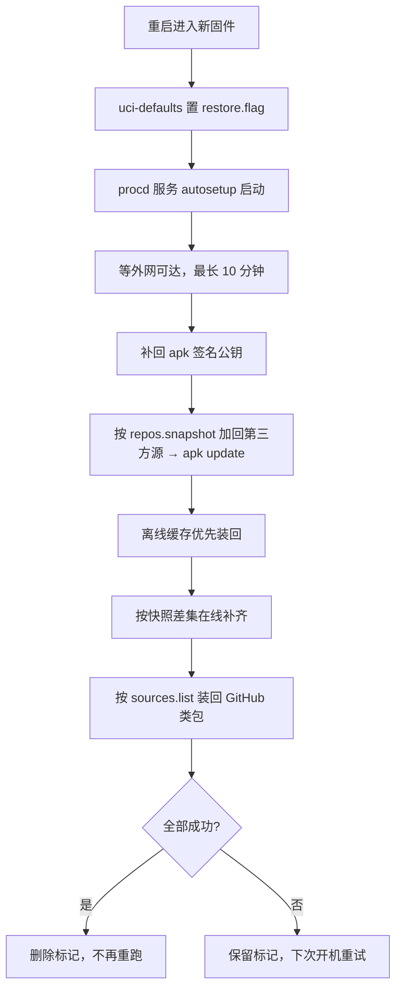

# OpenWrt 值守式升级 + 第三方包自动还原

面向 apk 版 OpenWrt（24.10+，实测 25.12.x / x86_64）。核心解决一件事：**用 Attended Sysupgrade 升级固件时，第三方包会被丢弃**。

`plan.md` 是实现思路与设计取舍；本文是可直接照做的操作指引。

---

## 1. 为什么要这个

Attended Sysupgrade（`owut` / LuCI ASU）把设备已装包清单发给构建服务器，服务器只用**官方 feed** 解析（`sysupgrade.openwrt.org` 的 `overview.json` 中 `repository_allow_list` 为空）。因此：

| 包 | 来源 | 能否烘焙进镜像 |
|---|---|---|
| `acme`、`dnsmasq-full` 等 | 官方 feed | ✅ 可以 |
| `nikki`、`luci-app-nikki` | 第三方 feed | ❌ 服务器不认该源 |
| `luci-app-openclash`、`luci-theme-argon` | GitHub Release | ❌ 不在任何 feed |
| `mihomo-alpha`（OpenClash 内核） | OpenClash 自行下载 | ❌ 且无法自动还原 |

结果就是：升级完只剩官方包。本方案在 ASU 之外补一层"**升级前自动备份、开机后自动装回**"，并且：

- **不写死包名**：第三方包由「已装清单 − 官方源索引」现算
- **不写死源**：升级前的第三方源行与签名公钥原样快照、原样加回
- **版本优先一致**：升级前把第三方包 apk 缓存下来，开机优先离线装回

---

## 2. 前置条件

- OpenWrt 24.10 及以上，包管理器是 `apk`（25.12 起自带 `owut`；24.10 需 `apk add owut`）
- 能访问外网（还原层要下载 apk、连 ASU 服务器）
- 系统已用 apk 正常装过第三方包（否则没有可还原的东西）

---

## 3. 一次性安装还原层

在路由器上执行：

```sh
cd /root
wget -O restore-install.sh https://raw.githubusercontent.com/rocdeng/openwrt-autosetup/main/restore/install.sh
sh restore-install.sh
```

它会完成：

1. 安装 `/etc/autosetup/setup.sh`（干活的主脚本；本目录没有 `setup.sh` 时会自动从仓库下载）
2. 生成 `/etc/autosetup/sources.list`（仅登记"任何 feed 都没有"的包，如 GitHub Release）
3. 安装 `/etc/init.d/autosetup` 并 enable（procd 服务，仅在有标记时干活）
4. 生成 `/etc/autosetup/asu-defaults.sh`（随镜像下发的 uci-defaults：置标记、重建服务并启动、重建短命令别名；**不含任何凭据**）
5. 配置 `owut` 的 `init_script`
6. 立即执行一次 `snapshot`

若访问 `raw.githubusercontent.com` 不稳定，可套用镜像前缀：

```sh
wget -O setup.sh https://gh-proxy.com/https://raw.githubusercontent.com/rocdeng/openwrt-autosetup/main/setup.sh
```

安装完成后确认：

```sh
grep autosetup /etc/sysupgrade.conf    # 必须有，否则升级后还原层会被丢弃
ls /etc/autosetup/                      # 应有 pkgs.snapshot / thirdparty.list / repos.snapshot / keys
cat /etc/autosetup/thirdparty.list      # 自动识别出的第三方包
```

> **`/etc/sysupgrade.conf` 这一条是整个方案的命门。** OpenWrt 的 `sysupgrade` 只保留白名单路径，自定义目录默认不保留；`snapshot` 每次都会自动补登记，但首次安装后请确认它确实写进去了。

---

## 4. 日常升级：一条命令

```sh
autosetup upgrade
```

（安装器会建立 `/usr/bin/autosetup` 软链；该路径不在 sysupgrade 白名单，每次升级后由 uci-defaults 重建。等效写法 `sh /etc/autosetup/setup.sh upgrade`。）

内部顺序：

1. **快照**：已装包清单 → `pkgs.snapshot`；识别第三方包 → `thirdparty.list`；第三方源行 → `repos.snapshot`；签名公钥 → `keys/`；第三方包 apk → `apk-cache/`
2. **剔除**：把 `thirdparty.list` 现算成 `owut upgrade -r <包名...>`
3. **升级**：`owut upgrade -r ... -I /etc/autosetup/asu-defaults.sh --progress-size 1000`（构建 → 下载 → 校验 → 刷机 → 重启）

升级期间会断网几分钟。镜像下载完开始刷机后**绝不可中断**。

## 5. 升级后自动发生什么



日志：

```sh
cat /etc/autosetup/restore.log      # 完整记录（推荐，持久化）
logread -e autosetup                # syslog 摘要
```

## 6. 升级前后检查清单

升级前：

```sh
cat /etc/autosetup/thirdparty.list          # 应包含你装的第三方包
ls /etc/autosetup/apk-cache/                # 第三方包 apk 是否已缓存
ls /etc/autosetup/keys/                     # 第三方源公钥是否已备份
grep autosetup /etc/sysupgrade.conf         # 还原层是否会被保留
```

升级后：

```sh
cat /etc/autosetup/restore.log
apk info -e nikki luci-app-nikki            # 第三方包是否回来了
ip route show default && nslookup www.baidu.com
```

## 6.5 手工操作清单（全生命周期只有 3 处）

| # | 时机 | 操作 | 频率 |
|---|---|---|---|
| 1 | 首次部署 | `wget` + `sh restore-install.sh` | 一次 |
| 2 | 每次升级 | `autosetup upgrade` | 每次 |
| 3 | 升级后 | OpenClash 页面重新下载 mihomo 内核 | 每次（无 feed 可选，唯一无法自动化项） |

除此之外全自动：快照、识别第三方包、缓存 apk、备份公钥与源、剔除构建清单、生成还原标记、开机等待网络、补公钥、回放源、离线装回、在线补齐、写日志。

### 可选：定时自动升级（默认关闭）

想进一步免手工，可用 cron 定期执行（**注意会自动重启路由器，建议放在凌晨并先手动验证一轮**）：

```sh
echo '0 4 * * 6 /bin/sh /etc/autosetup/setup.sh upgrade >> /etc/autosetup/cron.log 2>&1' >> /etc/crontabs/root
/etc/init.d/cron restart
```

风险：升级期间断网数分钟；若新版固件配置不兼容（`sysupgrade -n`），静态 IP 会丢，还原层无法联网。仅在你接受"周末凌晨自动重启"时启用；删除对应 crontab 行并 `restart cron` 即可关闭。

## 7. 已知边界

| 边界 | 说明 | 处理 |
|---|---|---|
| `mihomo-alpha`（OpenClash 内核） | 不在任何 feed，脚本升级前就会点名告警 | 升级后在 OpenClash「版本更新」里重新下载 |
| 历史 GitHub 包的来源 | 无法从系统反推仓库地址 | 一次性登记：`echo 'owner/repo 包名' >> /etc/autosetup/sources.list`（此后安装会自动登记） |
| 跨大版本 `sysupgrade -n` | 配置不保留 → 静态 IP 丢失 → 还原层无法联网 | 先手工恢复网络再跑 `sh /etc/autosetup/setup.sh restore` |
| ASU 下载慢 | `sysupgrade.openwrt.org` 的 store 节点在国内常被限速 | 可换服务器：`uci set attendedsysupgrade.server.url='https://sysupgrade.guerra24.net'` |
| `-I` 上传的脚本 | 内容会发到构建服务器，可从构建哈希公开下载 | 该文件只置标记、不含凭据，切勿往里放密码 |
| 官方镜像构建时长 | ASU 排队+构建通常 2–5 分钟 | 正常现象 |
| OpenClash 内核可选保留 | `/etc/openclash/core/` 加进 `/etc/sysupgrade.conf` 即可跨升级保留，省掉手工下载 | 内核常 50–100MB，会打进内存中的备份包；小内存别加，建议维持手工下载 |
| 备份体积 | `/etc/autosetup` 会整体进 sysupgrade 备份包，而该包在 `/tmp`（内存）中生成 | 小内存设备（64–128MB）若第三方包很多，可先 `du -sh /etc/autosetup` 确认；必要时删 `apk-cache/` 只保留在线还原 |

## 8. 故障排查（都是实测踩过的）

| 症状 | 根因 | 处理 |
|---|---|---|
| `Interface wan not found` | 接口名写死 `wan`，实际是 `lan`/其它 | 现代码按 `ip route get` → UCI 反查逻辑接口，无需处理 |
| 升级后 `Network unreachable` | `ifup` 重载清空内核默认路由 | 现代码对静态接口用 `network.<iface>.gateway`，并在重载后校验补回 |
| `Package 'x/if-installed' is not installed` | 旧版 `owut` 不支持该后缀 | 现代码只传纯包名 |
| `ubus: Request timed out ... pre-install.sh` | `owut -p` 钩子经 `ubus file exec` 有超时 | 已移除该钩子，快照在 `upgrade` 开头完成 |
| 升级后清单/缓存全丢 | `/etc/autosetup` 不在 sysupgrade 白名单 | 已自动登记；若仍丢失，检查 `/etc/sysupgrade.conf` |
| `UNTRUSTED signature` | 第三方源公钥在 `/etc/apk/keys`，同样不被保留 | 已随快照备份并自动补回；手动修复：重跑该源的 `feed.sh` |
| 升级后什么都没恢复，日志无记录 | `restore.flag` 未生成（`-I` 未生效） | `touch /etc/autosetup/restore.flag && /etc/init.d/autosetup start` |
| `1 packages missing in target version` | 第三方包未被剔除（清单为空或识别失败） | 先 `sh /etc/autosetup/setup.sh mirror` 刷新索引，再 `snapshot` 确认清单 |

## 9. 设备上的文件落点

| 路径 | 作用 |
|---|---|
| `/etc/autosetup/setup.sh` | 主脚本（服务与手动命令都调它） |
| `/etc/autosetup/pkgs.snapshot` | 升级前已装包清单（全量） |
| `/etc/autosetup/world.snapshot` | 升级前显式安装的顶层包（还原按它比对，依赖交给 apk） |
| `/etc/autosetup/release.snapshot` | 升级前的发行版与版本号，用于跨版本判断 |
| `/etc/autosetup/github-cache/` | GitHub 类包的 apk 离线副本 |
| `/etc/autosetup/thirdparty.list` | 自动识别出的第三方包 |
| `/etc/autosetup/repos.snapshot` | 升级前的第三方源行 |
| `/etc/autosetup/keys/` | 第三方源签名公钥备份 |
| `/etc/autosetup/apk-cache/` | 第三方包 apk 离线备份（版本锁定） |
| `/etc/autosetup/sources.list` | 只能从 GitHub 获取的包的来源登记 |
| `/etc/autosetup/restore.log` | 每次开机还原的完整日志 |
| `/etc/autosetup/cron.log` | 启用定时升级时的输出 |
| `/etc/init.d/autosetup` | procd 服务，有 `restore.flag` 才执行一次 |
| `/etc/autosetup/asu-defaults.sh` | 随镜像下发的 uci-defaults，仅置标记（放在保留目录内） |
| `/etc/autosetup/init.d-autosetup` | procd 服务文件副本，升级后据此重建 `/etc/init.d/autosetup` |

## 10. 手动操作速查

```sh
# 只看网络与 DNS（异常时自动配网关/DNS）
sh /etc/autosetup/setup.sh netcheck

# 重建清单与备份（升级前确认用）
sh /etc/autosetup/setup.sh snapshot

# 手动触发一次还原
sh /etc/autosetup/setup.sh restore

# 重新跑 Nikki 源（重装公钥+源+包）
sh /etc/autosetup/setup.sh nikki

# 短命令（等同 sh /etc/autosetup/setup.sh）
autosetup netcheck
autosetup snapshot
autosetup restore

# 更新脚本本身
wget -O /etc/autosetup/setup.sh https://raw.githubusercontent.com/rocdeng/openwrt-autosetup/main/setup.sh
ln -sf /etc/autosetup/setup.sh /usr/bin/autosetup

# 指定上级网关 / DNS
sh /etc/autosetup/setup.sh netcheck --gateway 192.168.1.1 --dns 223.5.5.5
```

## 11. 仓库结构

```
openwrt-after-upgrade/
├── setup.sh            # 主脚本（netcheck/mirror/openclash/nikki/argon/cert/snapshot/restore/upgrade）
├── restore/
│   └── install.sh      # 还原层安装器（自包含，内嵌各钩子脚本）
├── README.md           # 本操作指引
└── plan.md             # 设计思路与关键取舍
```
